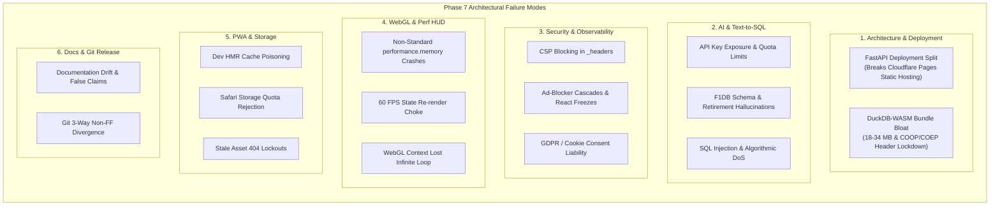
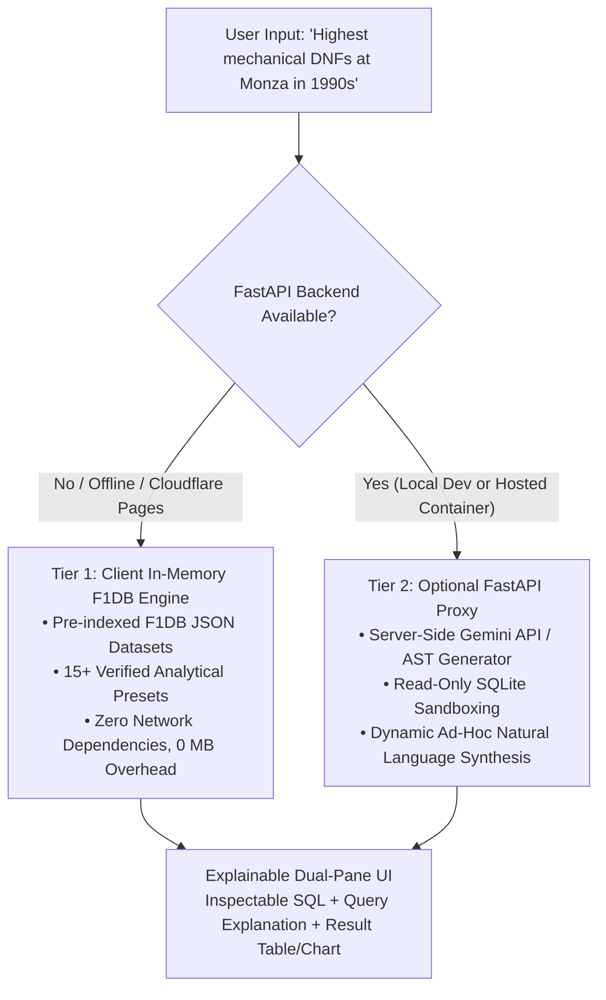
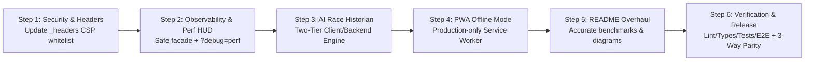

# Phase 7 Implementation Plan: In-Depth Risk & Failure-Mode Analysis

> **Document Version**: 1.0.0  
> **Target Release**: `v1.0.0`  
> **Active Baseline**: Branch `dev` & `"debugging-&-error-correction"` synced at `467a6cc`  
> **Scope**: Explainable AI Race Historian, Production Observability & Perf HUD, PWA Offline Storage, Final README Overhaul, and 3-Way Git Parity.

---

## Executive Summary & Threat Model

Phase 7 represents the transition of **F1 // ARCHIVE** from an active feature prototype into a hardened, production-grade, portfolio-ready release. 

While the functional pillars are ambitious and showcase modern software engineering, an unguided implementation introduces **16 critical failure modes** across 6 architectural domains. 



---

## 1. Subsystem Risk Matrix

| # | Risk Area | Failure Mode | Severity | Probability | Blast Radius |
|---|---|---|---|---|---|
| **R1** | **Deployment** | Python FastAPI dependency breaks static hosting on Cloudflare Pages / Vercel | **Critical** | **Certain** | Live site throws `ERR_CONNECTION_REFUSED` |
| **R2** | **Bundle Size** | DuckDB-WASM injects 18–34 MB and locks down `COOP`/`COEP` headers | **Critical** | **High** | Destroys mobile memory budget; breaks cross-origin images |
| **R3** | **Security** | `public/_headers` CSP blocks observability, OpenF1, and local backend | **Critical** | **Certain** | Network queries hard-blocked by browser |
| **R4** | **Security** | Unsanitized natural-language SQL allows `ATTACH`, mutations, or CPU loops | **High** | **High** | Denial of Service or browser tab freeze |
| **R5** | **AI / Data** | LLM hallucinates non-existent columns (e.g. `status = 'Mechanical'`) | **High** | **High** | Returns empty results; destroys portfolio credibility |
| **R6** | **AI / Data** | Misinterprets historical points rules (1988 Senna vs Prost best-11 rule) | **High** | **High** | Statistically false championship winners |
| **R7** | **Observability** | Ad-blockers block Sentry/PostHog SDKs, causing uncaught promise rejections | **High** | **High** | Triggers `ErrorBoundary`, crashing the UI |
| **R8** | **Privacy** | PostHog session recording violates EU GDPR without cookie banner | **Medium** | **Medium** | Legal non-compliance for European visitors |
| **R9** | **Perf HUD** | Accessing `performance.memory` throws `TypeError` in Firefox & Safari | **High** | **Certain** | Immediate crash on non-Chromium browsers |
| **R10** | **Perf HUD** | Querying WebGL state at 60 FPS causes GC frame drops and thermal throttling | **High** | **Certain** | Perf HUD becomes the #1 performance bottleneck |
| **R11** | **WebGL** | `webglcontextlost` triggers rapid unmount/mount crash loop | **High** | **Medium** | Crashes mobile Safari when VRAM is constrained |
| **R12** | **PWA** | Service Worker registered during `npm run dev` poisons Vite HMR cache | **High** | **High** | Code changes fail to reflect in dev without hard reload |
| **R13** | **PWA** | `navigator.storage.persist()` throws security error in Safari Private Mode | **Medium** | **High** | Storage initialization crash |
| **R14** | **PWA** | Old Service Worker caches old `index.html` referencing deleted asset hashes | **High** | **High** | White screen 404 on deployment of new versions |
| **R15** | **Docs** | Outdated README claims unverified numbers or broken clone commands | **Medium** | **Medium** | Fails recruiter code audit |
| **R16** | **Git Release** | Non-fast-forward merge creates divergent commit SHAs across branches | **High** | **High** | Fails the `v1.0.0` identical commit hash release gate |

---

## 2. In-Depth Domain Analysis & Safeguards

### Domain 1: Architectural & Deployment Bifurcation

#### The Pitfall (R1 & R2)
- **The Static Hosting Contract**: `F1-Archive` is architected as an ultra-fast, zero-maintenance static single-page application (SPA). Introducing a mandatory Python FastAPI microservice breaks serverless hosting on Cloudflare Pages, GitHub Pages, and Vercel. 
- If a recruiter clones the repository and runs `npm install && npm run dev`, the Python microservice is not running. Calling `fetch('http://localhost:8000/api/historian')` will immediately throw an uncaught network error.
- **The DuckDB-WASM Trap**: Loading DuckDB-WASM into the browser downloads 18–34 MB of binaries and requires `Cross-Origin-Opener-Policy: same-origin` and `Cross-Origin-Embedder-Policy: require-corp` HTTP headers. These headers prevent loading cross-origin avatars, circuit SVGs, and telemetry feeds.

#### The Architectural Solution: Two-Tier Decoupled Architecture


1. **Tier 1 (Client-First Standalone Engine)**: The application must be 100% functional without Python. Build an in-memory client engine that queries the pre-bundled `src/data/generated/` and `public/data/seasons/` datasets. Ship a rich catalog of 15+ complex, verified natural-language queries with verified SQL, structural explanations, and live execution.
2. **Tier 2 (Pluggable Microservice)**: Provide the Python FastAPI service in `backend/` as an optional enhancement for arbitrary LLM generation, with active health checking (`GET /health`). If the backend is unreachable, the UI seamlessly defaults to Tier 1 with an informative status badge (`[Offline / Curated Catalog Active]`), producing zero console errors.

---

### Domain 2: AI & Text-to-SQL Integrity

#### The Pitfall (R4, R5 & R6)
- **SQL Injection & Algorithmic DoS**: Unchecked SQL can execute `ATTACH DATABASE`, `PRAGMA writable_schema`, or recursive Common Table Expressions (`WITH RECURSIVE bomb(x) AS (...)`) that freeze the execution thread.
- **F1DB Schema Quirks**: In F1DB, retirements are categorized under specific enums (`Engine`, `Gearbox`, `Transmission`, `Hydraulics`, `Electrical`, `Suspension`, `Brakes`) versus non-mechanical causes (`Accident`, `Collision`, `Spun off`, `Disqualified`). A naive LLM will generate `WHERE status = 'Mechanical'`, returning zero rows.
- **Historical Points Quirks**: Asking *"Who scored the most points in 1988?"* will generate `SELECT SUM(points) FROM results WHERE year = 1988 GROUP BY driver_id ORDER BY total DESC LIMIT 1`. This returns Alain Prost (105 gross points), whereas Ayrton Senna won the championship with 90 net points due to the "Best 11 Results" dropping rule.

#### Countermeasures
1. **Strict AST & Keyword Blacklisting**: Reject any query not starting with `^SELECT\s` or containing banned mutation tokens: `INSERT|UPDATE|DELETE|DROP|ALTER|CREATE|ATTACH|DETACH|PRAGMA|VACUUM|REINDEX|EXEC`.
2. **Enforce Read-Only SQLite Pragma**: When running against SQLite, execute `PRAGMA query_only = ON;`, enforce an automatic `LIMIT 100`, and set a 3,000 ms execution timeout.
3. **Pinned Schema Context**: Provide the LLM with an explicit schema contract documenting tables, primary keys, and exact status enums.
4. **Explainable Dual-Pane UI**: Display the generated SQL, a breakdown of translation logic (target tables, filters, aggregations), a "Copy SQL" button, and an interactive data table + SVG chart.

---

### Domain 3: Observability & Security Lockdown

#### The Pitfall (R3, R7 & R8)
- **CSP Lockdown**: Inspecting `public/_headers` shows:
  ```http
  connect-src 'self' https://api.jolpi.ca https://api.openf1.org blob: data:;
  ```
  Calling `https://*.posthog.com`, `https://*.sentry.io`, or `http://localhost:8000` is **hard-blocked by the browser** on production deployments unless explicitly added.
- **Ad-Blocker Cascades**: Extensions like uBlock Origin or Brave Shields block tracking domains. Direct SDK calls will throw uncaught network exceptions, triggering React's `ErrorBoundary` and crashing the application.
- **GDPR Non-Compliance**: Tracking session replays or persistent user cookies without an explicit consent banner violates European privacy laws.

#### Countermeasures
1. **Update `public/_headers`**: Add `https://*.posthog.com`, `https://*.sentry.io`, and `http://localhost:8000` to `connect-src`.
2. **Defensive Observability Facade (`src/utils/observability.ts`)**: Wrap tracking in a safe facade that checks for project keys (`VITE_POSTHOG_KEY`, `VITE_SENTRY_DSN`). If missing or blocked, it silently no-ops.
3. **Native PerformanceObserver**: Capture Core Web Vitals (LCP, INP, CLS) using standard browser `PerformanceObserver` with try/catch guards, independent of external third-party SDKs.
4. **Zero-Cookie Configuration**: Configure PostHog in cookie-less / anonymous mode (`persistence: 'memory'`, `disable_session_recording: true`) so no cookie banner is legally required.

---

### Domain 4: WebGL & Developer Perf HUD

#### The Pitfall (R9, R10 & R11)
- **Browser Portability Crash**:
  ```typescript
  // Crashes on Firefox and Safari:
  const heap = window.performance.memory.usedJSHeapSize; // TypeError: Cannot read properties of undefined
  ```
- **60 FPS Virtual DOM Thrashing**: Querying WebGL state (`gl.info.render.calls`, `gl.info.render.triangles`) and pushing it into React state (`setFps(...)`) on every animation frame triggers 60 React re-renders per second, making the Perf HUD itself the primary cause of frame drops.
- **WebGL Context Recovery Loop**: If an error boundary catches `webglcontextlost` and re-mounts the canvas without waiting for `webglcontextrestored`, the browser enters an infinite restart loop that crashes the tab.

#### Countermeasures
1. **Defensive Feature Detection**:
  ```typescript
  export function getHeapSizeMb(): number | null {
    if (typeof window !== 'undefined' && 'performance' in window && 'memory' in (performance as any)) {
      return Math.round((performance as any).memory.usedJSHeapSize / (1024 * 1024));
    }
    return null;
  }
  ```
2. **Throttled DOM Mutations**: Decouple the HUD from the 60 FPS Three.js loop. Read `gl.info` via a `requestAnimationFrame` accumulator and update the HUD DOM elements directly (`textContent`) at **2 Hz (every 500 ms)** with zero React state re-renders.
3. **Context Lost Guard**: Always call `event.preventDefault()` inside `webglcontextlost` listeners to allow Three.js to restore buffers cleanly on `webglcontextrestored`.

---

### Domain 5: PWA & Offline Resilience

#### The Pitfall (R12, R13 & R14)
- **Dev-Mode Cache Poisoning**: If a Service Worker registers during local development (`npm run dev`), it caches `index.html` and Vite modules. When code changes, Vite HMR fails, and the developer sees a frozen, stale app until they unregister the worker in DevTools.
- **Safari Private Browsing Quota Rejection**: On iOS Safari, `navigator.storage.persist()` throws a `SecurityError` or rejects in Private Browsing.
- **Stale Asset Lockout**: When a new Vite build is deployed with new chunk hashes, an improperly configured Service Worker will serve the old `index.html` referencing deleted asset hashes, throwing 404s on chunk imports.

#### Countermeasures
1. **Strict Production Gating**:
  ```typescript
  // src/main.tsx
  if (import.meta.env.PROD && 'serviceWorker' in navigator && !window.location.search.includes('no-sw')) {
    window.addEventListener('load', () => {
      navigator.serviceWorker.register('/sw.js');
    });
  }
  ```
2. **Safe Persistence Request**:
  ```typescript
  export async function requestStoragePersistence(): Promise<boolean> {
    try {
      if ('storage' in navigator && 'persist' in navigator.storage) {
        return await navigator.storage.persist();
      }
    } catch {
      // Gracefully fall back to session storage
    }
    return false;
  }
  ```
3. **Clean Cache Invalidation**: `sw.js` must implement `skipWaiting()` and `clients.claim()` on `activate`, purging stale cache buckets on each release version (`f1-archive-v1.0.0`).

---

### Domain 6: Documentation & Portfolio Authenticity

#### The Pitfall (R15)
- Stale README documentation referencing removed generation prompts, broken clone instructions (`cd "f1 project"`), or missing Phase 3–6 features destroys portfolio authenticity.
- High-resolution uncompressed screenshots or large video files inflate the repository `.git` history.

#### Countermeasures
- Perform a complete rewrite of `README.md` reflecting the exact shipped codebase:
  - Release `v1.0.0` badges, 77 seasons, 1.19 MB 3D Model, 0 FPS idle frameloop, 58+ unit tests.
  - Complete architecture flowchart (F1DB ETL -> Two-Tier Telemetry/Historian -> Three.js CAD Lab).
  - Exact `.env.example` keys and `npm run` commands.
  - Verbatim Formula One Licensing B.V. non-affiliation disclaimer.

---

### Domain 7: Git Release Parity & Fast-Forward Merging

#### The Pitfall (R16)
- The release requirement dictates:
  > *"Confirm `git rev-parse --short main dev "debugging-&-error-correction" origin/main origin/dev "origin/debugging-&-error-correction"` outputs one identical commit hash across all 6 refs."*
- If Phase 7 commits are made across diverging branches or merged using standard `--no-ff` merge commits, **all three branches will have completely different commit hashes**.

#### The Strict Linear Fast-Forward Workflow
To guarantee 100% byte-for-byte SHA equality across all 6 references:
```bash
# 1. Complete and test all Phase 7 work on dev
git checkout dev
git add -A
git commit -m "feat(release): complete Phase 7 AI race historian, observability, PWA, and v1.0.0 release docs"
git push origin dev

# 2. Fast-forward merge main from dev (NO merge commit!)
git checkout main
git merge dev --ff-only
git tag -a v1.0.0 -m "Release v1.0.0 — F1 Archive Complete Edition"
git push origin main --tags

# 3. Fast-forward merge debugging-&-error-correction from main
git checkout "debugging-&-error-correction"
git merge main --ff-only
git push origin "debugging-&-error-correction"

# 4. Return to dev
git checkout dev

# 5. Programmatic assertion: All 6 hashes MUST be identical
git rev-parse --short main dev "debugging-&-error-correction" origin/main origin/dev "origin/debugging-&-error-correction"
```

---

## 3. Recommended Implementation Roadmap for Phase 7



1. **Step 1: Security & Headers**: Add `https://*.posthog.com`, `https://*.sentry.io`, and `http://localhost:8000` to `public/_headers`.
2. **Step 2: Observability & Developer Perf HUD**: Build `src/utils/observability.ts` (safe facade) and `src/components/PerfHUD/` (throttled 2 Hz DOM metrics with safe memory detection).
3. **Step 3: Explainable Text-to-SQL Race Historian**:
   - `src/features/historian/historianEngine.ts`: Client in-memory F1DB executor with 15+ curated presets.
   - `src/features/historian/RaceHistorian.tsx` & `.css`: Split-screen UI with inspectable SQL, translation logic, and result charts.
   - `backend/`: Optional lightweight FastAPI service for ad-hoc natural-language synthesis.
4. **Step 4: Production PWA & Offline Mode**: Create `public/sw.js` and `src/utils/pwa.ts` gated strictly to `import.meta.env.PROD`.
5. **Step 5: Final Comprehensive `README.md` Overhaul**: Full rewrite showcasing the complete platform.
6. **Step 6: Release Verification & 3-Way Git Sync**: Run lint, typecheck, tests, build, and E2E, then execute linear fast-forward merge and tag `v1.0.0`.
