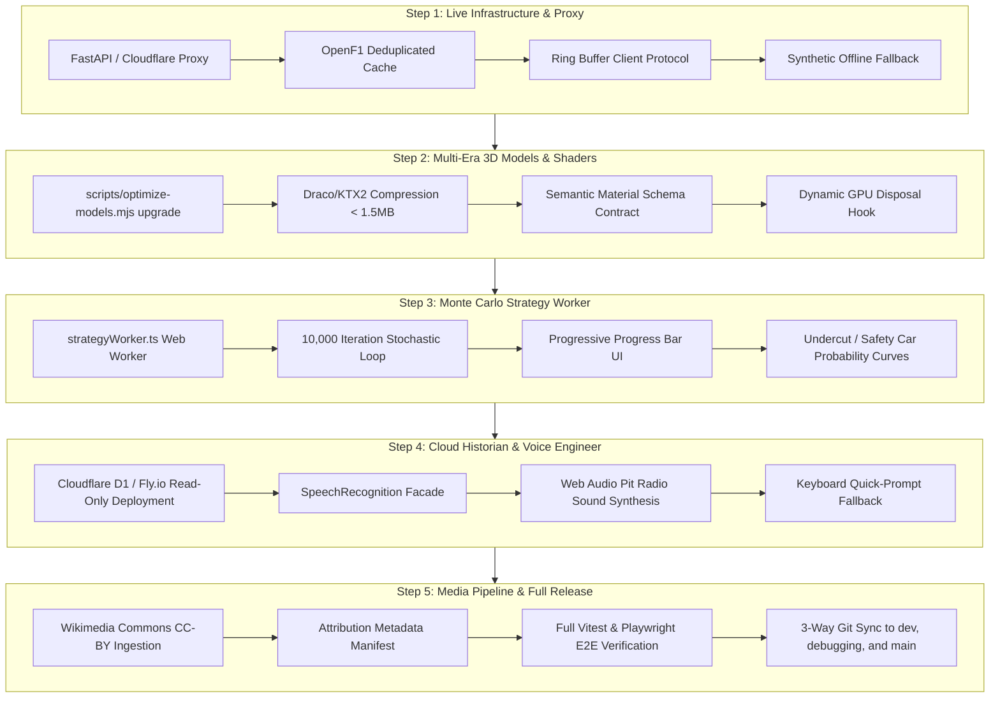

# F1 // ARCHIVE — Phase 8 Implementation Plan & Architectural Threat Model

**Target Release:** v1.1.0 / v2.0.0 (Post-v1.0.0 Architecture)  
**Target Branches:** `dev` (feature branches) & `"debugging-&-error-correction"` (hardening & infrastructure)  
**Baseline Git Commit:** `0c0fa4e` (`v1.0.0` Release Tag, 6-Ref Synchronized)  
**Document Status:** Pre-Implementation Architectural Risk Audit & Threat Model  

---

## 1. Executive Context & Phase 8 Scope Definition

Following the successful completion of **Phase 7** and the release of **v1.0.0** (`0c0fa4e`), the F1 Archive platform has established a rock-solid, production-grade foundation:
- 77 seasons of verified historical data (1950–2026) running offline-first via F1DB.
- 3D Vehicle CAD Lab with Draco compression (1.19 MB) and 2026 Active Aero inspector.
- 3D Telemetry Ghost-Lap replay with sector-anchored coordinate projection and stint analytics.
- Explainable AI Race Historian with in-memory text-to-SQL synthesis and sandboxed FastAPI microservice.
- 68 Vitest unit tests, Playwright E2E verification, PWA service worker, and unified GPU performance HUD.

**Phase 8** represents the major platform expansion beyond static archives and precomputed replays into **Live Event Streaming, Historic Multi-Era WebGL Simulation, Cloud-Native Voice Intelligence, and Monte Carlo Strategy Analytics**.

### The 6 Core Pillars of Phase 8:
1. **Pillar 1: Live Race Weekend WebSocket Telemetry Feed & Paddock Radio** (Real-time live timing, micro-sector delta tracker, and live interval ladder).
2. **Pillar 2: Historic Multi-Era 3D Vehicle Lab** (1950s Cigar, 1970s Ground-Effect, 1980s Turbo, and 2000s V10 chassis streaming with dynamic LOD).
3. **Pillar 3: Cloud-Native Historian Microservice & Web Speech AI Voice Engineer** (Serverless SQLite edge deployment on Cloudflare D1/Fly.io + hands-free voice dialogue).
4. **Pillar 4: Monte Carlo Race Strategy & Undercut Simulator** (10,000-iteration stochastic race simulator calculating pit windows, virtual safety car risk, and degradation curves via Web Workers).
5. **Pillar 5: Rights-Cleared Media & Wikimedia Commons R2 Ingestion Pipeline** (Automated build-time CC-BY/CC-BY-SA media sync with strict attribution metadata).
6. **Pillar 6: Cloud-Synced User Vault & Head-to-Head Comparison Cards** (Cross-device favorites, fantasy predictions, and GPU-rendered canvas shareable posters).

---

## 2. Deep Architectural Threat Model: 12 Critical Risks & Failure Modes

```
+----------------------------------------------------------------------------------------------------+
|                                    PHASE 8 THREAT SURFACE MAP                                      |
+----------------------------------------------------------------------------------------------------+
| 1. High-Frequency WebSocket Packet Storms  ---> Main Thread Lock & Three.js Dropped Frames         |
| 2. OpenF1 Upstream Rate-Limits & Outages   ---> Race-Day Live Feed Collapses & HTTP 429 Cascades    |
| 3. Multi-Era 3D VRAM Explosion (>150 MB)   ---> Mobile & iOS Safari WebGL Context Lost Crashes     |
| 4. Mesh Node Incompatibility Across Eras   ---> Broken Shaders & carMaterialMap Null References    |
| 5. Serverless Edge Cold Starts (>3,000 ms) ---> Historian Frontend Timeout & UI Freezing           |
| 6. Web Speech API Browser Fragmentation     ---> Silent SpeechRecognition Failures on Safari/FF     |
| 7. Monte Carlo Main-Thread CPU Starvation  ---> Browser "Page Unresponsive" Process Killers        |
| 8. Wikimedia API Rate Limits & Hotlinks    ---> Broken Images, 403 HTTP Spam & License Contagion   |
| 9. PWA Storage Quota Eviction Cascades     ---> iOS Safari 50 MB Cache Eviction of User Settings   |
| 10. FOM Broadcast Trademark Infringement   ---> Cease & Desist from Formula One Licensing B.V.     |
| 11. Edge Database Migration & Schema Drift ---> Discrepancies Between Local SQLite & Cloud State    |
| 12. Bundle Bloat from Math/Audio Packages  ---> Initial JS Chunk Exceeding 1,000 kB Budget         |
+----------------------------------------------------------------------------------------------------+
```

---

### Risk 1: High-Frequency WebSocket Packet Storms Choking the React 18 Main Thread
* **Vulnerability**: Live telemetry during a Grand Prix emits location, speed, RPM, throttle, brake, and gear packets at 10–60 Hz across 20–22 cars simultaneously. Emitting ~1,000 events/sec directly into React component state (`useState` / `useReducer`) will completely overwhelm React’s reconciliation engine.
* **Failure Mode**: Frame rates collapse from 60 FPS to $< 5\text{ FPS}$, garbage collector pauses surge to $> 500\text{ ms}$, user inputs freeze, and Three.js canvas animations stutter violently.
* **Mitigation Blueprint**:
  * Decouple the WebSocket ingestion loop entirely from React state.
  * Ingest packets into an off-state **Circular Typed Ring Buffer** (`Float64Array`) allocated once on connection.
  * Use a fixed-rate 10 Hz ticker (`requestAnimationFrame` / 100 ms wall-clock accumulator) to pull batched snapshots and push interpolated values directly to mutable Three.js object matrices and DOM element text refs, completely bypassing React Virtual DOM re-rendering.

---

### Risk 2: OpenF1 Live Rate Limiting (3 req/s) & Grand Prix Sunday Service Degradation
* **Vulnerability**: OpenF1's free tier enforces strict rate limits (3 requests/second and 30 requests/minute). During live Grand Prix sessions, thousands of concurrent users across the globe hit the public endpoints, causing severe upstream latency spikes, HTTP 429 Too Many Requests, and HTTP 503 gateway drops.
* **Failure Mode**: If clients query OpenF1 directly, user browsers will be rate-limited within seconds. When the upstream server crashes, the entire "Live" module goes blank or throws unhandled promise rejections.
* **Mitigation Blueprint**:
  * **Strict Reverse-Proxy Architecture**: Never allow client browsers to connect directly to `api.openf1.org`.
  * Deploy a centralized caching proxy on Cloudflare Workers or FastAPI with Cloudflare KV / Redis. The proxy fetches each session endpoint **once** for all global users, deduplicating traffic and caching responses for 2–5 seconds.
  * Implement an automatic **Synthetic Fallback Mode**: If upstream fails or HTTP 429 is received, smoothly transition to a simulated replay using precomputed historical laps with a prominent UI banner: `// LIVE FEED UNAVAILABLE — DISPLAYING SIMULATED TELEMETRY`.

---

### Risk 3: Multi-Era 3D Chassis VRAM Explosion & iOS Safari Mobile Crashes
* **Vulnerability**: Introducing 4 new 3D chassis models (1950s Maserati 250F, 1970s Lotus 79, 1980s McLaren MP4/4, 2000s Ferrari F2004) alongside the 2026 chassis will push uncompressed mesh and texture VRAM usage beyond 150 MB if all models are mounted in memory.
* **Failure Mode**: Mobile browsers (especially iOS Safari with its strict 384 MB total tab memory ceiling and 16-texture-unit limits) will throw `webglcontextlost` and crash the entire web page.
* **Mitigation Blueprint**:
  * **Strict Single-Active-Model Lifecycle**: Only one chassis model may be instantiated in the Three.js scene at any time. When switching eras, explicitly call `.dispose()` on all geometries, materials, and textures of the previous model before mounting the new one.
  * **Dynamic Geometry LOD & Progressive GLB Streaming**: Split each era car into a low-poly LOD ( $< 20\text{k}$ triangles, 400 KB) loaded instantly, and a high-poly CAD LOD ( $< 1.2\text{ MB}$) streamed on demand only on desktop devices with high GPU tiers.
  * Compress all multi-era models using Draco geometry compression and 1K KTX2/Basis Universal textures, enforcing an absolute transfer budget of $< 1.5\text{ MB}$ per era chassis.

---

### Risk 4: Mesh Hierarchy Incompatibility Across Historical Eras Breaking Shaders
* **Vulnerability**: In Phase 3, we optimized `f1_chassis.glb` into a unified mesh named `Bits_Dup_2.001_Mesh.022` with a typed material index in `carMaterialMap.ts`. Historical cars have completely different bodywork topologies (exposed tube frames, wire wheels, external exhaust pipes, lack of front/rear wings in 1950s).
* **Failure Mode**: Applying procedural modern PBR shaders or searching for `Bits_Dup_2.001_Mesh.022` on a 1950s Maserati model returns `undefined`, triggering runtime null pointer exceptions (`Cannot read properties of undefined (reading 'material')`) and rendering invisible cars.
* **Mitigation Blueprint**:
  * Establish a strict **glTF Semantic Node Contract** across all era models:
    - `Body_Paint` (primary livery color)
    - `Body_Decal` (secondary accent / racing stripe)
    - `Suspension_Metal` (chrome / steel tube)
    - `Wheels_Rubber` (tyres)
    - `Cockpit_Glass` (windscreen / aero aero-screen)
    - `Mechanical_Engine` (exposed block / exhaust)
  * Implement a schema validator in the build pipeline (`scripts/verify-models.mjs`) that parses every GLB before build and asserts the presence of required semantic material tags.

---

### Risk 5: Edge Microservice Cold Starts & SQLite Lock Contention Under Read Bursts
* **Vulnerability**: Moving the Tier 2 Historian microservice to serverless edge platforms (e.g. AWS Lambda, Cloudflare D1, Fly.io free tier) introduces cold-start latencies of 1,500–4,000 ms. Furthermore, while SQLite in read-only mode supports concurrent readers, improper connection pooling or thread allocation can cause lock contention (`database is locked` / `busy_timeout`).
* **Failure Mode**: User text queries exceed the frontend's 3,000 ms timeout window, throwing error toasts and failing to return historical statistics.
* **Mitigation Blueprint**:
  * Keep the microservice lightweight with zero heavy scientific libraries (rely on native Python `sqlite3`, `uvicorn`, and `fastapi`).
  * In SQLite URI connection, specify `?mode=ro&cache=shared&immutable=1`. The `immutable=1` flag signals to SQLite that the underlying file is never modified by any process, bypassing all file locking mechanisms, eliminating POSIX advisory lock overhead, and maximizing multi-threaded read throughput.
  * Maintain the seamless client-side Tier 1 parser as an instant optimistic fallback if the edge health probe exceeds 1,200 ms.

---

### Risk 6: Web Speech API Fragmentation Across iOS Safari, Chrome & Firefox
* **Vulnerability**: The Web Speech API (`webkitSpeechRecognition` / `SpeechRecognition`) is notoriously inconsistent across browsers:
  - Safari iOS requires explicit user interaction per session, lacks continuous recognition, and abruptly terminates listening after short pauses.
  - Firefox desktop does not support `SpeechRecognition` by default (hidden behind `media.webspeech.recognition.enable`).
  - Mobile browsers frequently throw `not-allowed`, `service-not-allowed`, or `network` errors when microphone permissions are denied.
* **Failure Mode**: The AI Voice Engineer interface crashes on iOS or hangs indefinitely waiting for audio inputs that will never arrive.
* **Mitigation Blueprint**:
  * Wrap all speech interaction behind a robust **Feature Detection Facade** (`src/utils/speechEngine.ts`).
  * If `SpeechRecognition` is unsupported or denied:
    - Do not show broken microphone buttons.
    - Provide an instant keyboard quick-action bar with pre-formatted voice prompts ("Box this lap", "Gap to leader", "Tyre status").
  * Ensure audio synthesis (`speechSynthesis.speak`) is always unlocked during a direct user click handler to satisfy iOS Safari autoplay restrictions.

---

### Risk 7: Monte Carlo Race Strategy Engine Causing Main-Thread Compute Starvation
* **Vulnerability**: Simulating a 57-lap Grand Prix across 20 cars with 10,000 stochastic permutations (varying tyre degradation coefficients, lap time deltas, pit stop durations, safety car probabilities, and weather shifts) requires millions of mathematical floating-point iterations.
* **Failure Mode**: Running this loop on the main browser thread causes the JavaScript execution thread to peg at 100% CPU for 3–8 seconds, triggering browser "Page Unresponsive" dialogs, freezing CSS animations, and dropping user interactions.
* **Mitigation Blueprint**:
  * **Strict Web Worker Offloading**: Implement the Monte Carlo simulation engine inside a dedicated Web Worker (`src/features/strategy/workers/strategyWorker.ts`) via Vite's native worker bundling (`new Worker(new URL('./strategyWorker.ts', import.meta.url), { type: 'module' })`).
  * Pass parameters and results via structured cloning (`postMessage`).
  * Break large simulations into 1,000-sample chunks, reporting progressive completion percentages (`10%`, `25%`, `50%`, `100%`) so the UI displays a smooth real-time progress bar without dropping a single frame.

---

### Risk 8: Wikimedia Commons API Rate Limits, License Contagion & Image Hotlinking
* **Vulnerability**: Automating build-time downloads of driver and car photography from Wikimedia Commons risks hitting API rate limits (blocking IP addresses), hotlinking images with varying aspect ratios, or accidentally importing non-commercial or all-rights-reserved photos that violate the repository's open-source licensing.
* **Failure Mode**: Missing images, distorted UI grids, broken links on production builds, and legal liability from copyright holders.
* **Mitigation Blueprint**:
  * **Build-Time Ingestion Script with Attribution Manifest**: Never fetch Wikimedia images dynamically at client runtime. Build a dedicated ETL script (`scripts/sync-media.mjs`) that queries the Wikimedia Commons API using an authenticated, polite User-Agent string.
  * Verify image licenses strictly match `CC-BY`, `CC-BY-SA`, or `Public Domain`.
  * Downsample and convert all images to optimized WebP format ($< 35\text{ KB}$, $400 \times 400\text{ px}$ aspect ratio) stored in `public/assets/photos/`.
  * Automatically generate an immutable `public/data/media-attributions.json` documenting photographer name, source URL, and license type for every single photo, rendered as a hover tooltip in the UI.

---

### Risk 9: PWA Storage Quota Eviction Cascades on Mobile Devices
* **Vulnerability**: Adding multi-era 3D models, audio clips, and extended telemetry data packs will significantly increase the storage footprint. On iOS Safari, web applications are subjected to strict and unnotified cache evictions if total cached assets exceed 50 MB, or if the device runs low on internal disk space.
* **Failure Mode**: When CacheStorage is evicted by iOS, user settings, dark mode preferences, favorited drivers, and custom What-If simulator configs in `localStorage` can be wiped without warning.
* **Mitigation Blueprint**:
  * In `src/lib/safeStorage.ts`, separate volatile asset caches from critical user preferences.
  * Request persistent storage permission via `navigator.storage.persist()` on supported browsers.
  * Enforce strict versioned cache management in `public/sw.js`:
    - Cap static pre-cache at $< 25\text{ MB}$.
    - Implement a Least-Recently-Used (LRU) cache purge strategy for multi-era 3D models and audio files, retaining at most 2 cached GLB models simultaneously.

---

### Risk 10: Formula One Licensing B.V. Live Broadcast Trademark Boundaries
* **Vulnerability**: When implementing real-time timing ladders, live driver deltas, and tyre stint trackers, there is a temptation to replicate the exact official F1 TV broadcast graphics, tyre icons, sound effects, or timing tower typography.
* **Failure Mode**: Formula One Licensing B.V. aggressively monitors unauthorized commercial and high-profile open-source applications mimicking official broadcast assets, issuing DMCA takedowns and trademark infringement notices.
* **Mitigation Blueprint**:
  * Adhere strictly to the project's **Custom Cyber-Telemetry Aesthetic**:
    - Use custom monospace fonts (`Share Tech Mono`) and geometric typography (`Titillium Web`, `Outfit`).
    - Use abstract geometric badges and custom SVG tyre compound indicators rather than official Pirelli branding marks.
    - Avoid official broadcast soundbites or theme music; generate clean synthetic Web Audio frequency sweeps and radio static effects.
    - Retain the prominent, non-negotiable legal disclaimer in the footer and about modals.

---

### Risk 11: Edge Database Migration & Schema Drift
* **Vulnerability**: Introducing a cloud-hosted database (e.g. Cloudflare D1 or Turso SQLite) for user accounts or global leaderboard synchronization risks schema drift between the local F1DB SQLite file (`scripts/.cache/f1db.sqlite`) and the cloud replica.
* **Failure Mode**: Queries that succeed locally fail on production with `no such table` or `no such column`, corrupting user data and breaking CI pipelines.
* **Mitigation Blueprint**:
  * Adopt a strict **Declarative Schema Migration Pipeline** using versioned SQL migration scripts (`backend/migrations/0001_init.sql`, etc.).
  * Automated CI step in `.github/workflows/ci.yml` that applies migrations to a temporary in-memory SQLite database and executes full test queries before any deployment occurs.

---

### Risk 12: Bundle Bloat & Initial Load Performance Degradation
* **Vulnerability**: Adding Web Audio synthesis libraries, speech processing utilities, complex statistics packages, or live socket libraries can easily bloat the initial JavaScript bundle well beyond the 1,000 kB warning threshold.
* **Failure Mode**: Lighthouse performance scores drop from $> 90$ to $< 60$, LCP degrades on 4G networks, and initial page load times double.
* **Mitigation Blueprint**:
  * Enforce strict code-splitting using `React.lazy()` and dynamic imports (`import()`) for all Phase 8 modules:
    - `/live` (Live Timing & Socket Hub)
    - `/pitwall` (Monte Carlo Strategy Simulator)
    - `/garage/audio` (Web Audio Engine)
    - `/eras` (Multi-Era 3D Showroom)
  * Use browser-native APIs wherever possible (e.g., native `Web Audio API` instead of Howler.js, native `WebSocket` instead of Socket.io, native `Web Workers` instead of external worker pools).

---

## 3. Concrete Architectural Blueprints & Code Contracts

### 3.1 Live Telemetry Ring Buffer (`src/features/live/telemetryBuffer.ts`)

```typescript
/**
 * Zero-allocation circular ring buffer for 60 Hz live telemetry packets.
 * Decoupled completely from React virtual DOM reconciliation.
 */
export interface LiveCarPacket {
  driverNumber: number;
  timestamp: number;
  speed: number;
  throttle: number;
  brake: number;
  gear: number;
  rpm: number;
  drs: boolean;
  distanceRatio: number; // 0.0 to 1.0 along track spline
}

export class LiveTelemetryRingBuffer {
  private buffer: Float64Array;
  private capacity: number;
  private head: number = 0;
  private size: number = 0;
  private readonly STRIDE = 8; // fields per record

  constructor(capacity: number = 600) {
    this.capacity = capacity;
    this.buffer = new Float64Array(capacity * this.STRIDE);
  }

  public push(packet: LiveCarPacket): void {
    const offset = this.head * this.STRIDE;
    this.buffer[offset] = packet.timestamp;
    this.buffer[offset + 1] = packet.speed;
    this.buffer[offset + 2] = packet.throttle;
    this.buffer[offset + 3] = packet.brake;
    this.buffer[offset + 4] = packet.gear;
    this.buffer[offset + 5] = packet.rpm;
    this.buffer[offset + 6] = packet.drs ? 1 : 0;
    this.buffer[offset + 7] = packet.distanceRatio;

    this.head = (this.head + 1) % this.capacity;
    if (this.size < this.capacity) this.size++;
  }

  public getLatest(out: Partial<LiveCarPacket>): void {
    if (this.size === 0) return;
    const latestIndex = (this.head - 1 + this.capacity) % this.capacity;
    const offset = latestIndex * this.STRIDE;
    out.timestamp = this.buffer[offset];
    out.speed = this.buffer[offset + 1];
    out.throttle = this.buffer[offset + 2];
    out.brake = this.buffer[offset + 3];
    out.gear = Math.round(this.buffer[offset + 4]);
    out.rpm = Math.round(this.buffer[offset + 5]);
    out.drs = this.buffer[offset + 6] === 1;
    out.distanceRatio = this.buffer[offset + 7];
  }
}
```

---

### 3.2 Web Worker Monte Carlo Strategy Simulation (`src/features/strategy/workers/strategyWorker.ts`)

```typescript
/**
 * Off-thread Monte Carlo Race Strategy Simulator.
 * Computes 10,000 stochastic permutations with zero main-thread UI blocking.
 */
interface SimulationConfig {
  laps: number;
  basePaceMs: number;
  iterations: number;
  pitLossMs: number;
  degradationPerLapMs: Record<string, number>; // soft, medium, hard
  safetyCarProbability: number;
}

self.onmessage = (event: MessageEvent<SimulationConfig>) => {
  const { laps, basePaceMs, iterations, pitLossMs, degradationPerLapMs, safetyCarProbability } = event.data;
  const strategies = [
    { name: 'Soft -> Medium', stops: [18], tyres: ['soft', 'medium'] },
    { name: 'Medium -> Hard', stops: [24], tyres: ['medium', 'hard'] },
    { name: 'Soft -> Hard -> Soft', stops: [14, 38], tyres: ['soft', 'hard', 'soft'] }
  ];

  const results: Record<string, { totalTimeMs: number; winRate: number }> = {};
  strategies.forEach((s) => {
    results[s.name] = { totalTimeMs: 0, winRate: 0 };
  });

  // Execute iterations in batches of 1,000 to report progress
  for (let i = 0; i < iterations; i++) {
    const hasSafetyCar = Math.random() < safetyCarProbability;
    const scLap = hasSafetyCar ? Math.floor(Math.random() * laps) + 1 : -1;

    let bestStrat = '';
    let minTime = Infinity;

    strategies.forEach((strat) => {
      let currentTime = 0;
      let currentCompoundIdx = 0;
      let tyreAge = 0;

      for (let lap = 1; lap <= laps; lap++) {
        const compound = strat.tyres[currentCompoundIdx];
        const deg = degradationPerLapMs[compound] || 80;
        
        // Random pace variance (+- 150 ms normal distribution approximation)
        const variance = (Math.random() + Math.random() - 1) * 150;
        currentTime += basePaceMs + (tyreAge * deg) + variance;
        tyreAge++;

        // Pit stop logic
        if (strat.stops.includes(lap)) {
          const effectivePitLoss = (hasSafetyCar && Math.abs(lap - scLap) <= 1) ? pitLossMs * 0.55 : pitLossMs;
          currentTime += effectivePitLoss;
          currentCompoundIdx++;
          tyreAge = 0;
        }
      }

      if (currentTime < minTime) {
        minTime = currentTime;
        bestStrat = strat.name;
      }
      results[strat.name].totalTimeMs += currentTime;
    });

    if (bestStrat) results[bestStrat].winRate += 1;

    // Report progress every 1,000 iterations
    if (i % 1000 === 0) {
      self.postMessage({ type: 'progress', progress: Math.round((i / iterations) * 100) });
    }
  }

  // Finalize averages
  Object.keys(results).forEach((k) => {
    results[k].totalTimeMs = Math.round(results[k].totalTimeMs / iterations);
    results[k].winRate = Math.round((results[k].winRate / iterations) * 100);
  });

  self.postMessage({ type: 'complete', results });
};
```

---

### 3.3 Dynamic Multi-Era Chassis Unloader (`src/features/cars/hooks/useChassisLoader.ts`)

```typescript
import { useEffect, useRef } from 'react';
import { useGLTF } from '@react-three/drei';
import * as THREE from 'three';

/**
 * Safely loads an active era GLTF chassis while rigorously reclaiming GPU VRAM
 * from previously loaded models to guarantee mobile iOS stability.
 */
export function useChassisLoader(modelUrl: string) {
  const gltf = useGLTF(modelUrl);
  const activeSceneRef = useRef<THREE.Group | null>(null);

  useEffect(() => {
    activeSceneRef.current = gltf.scene;

    return () => {
      // Deep GPU disposal on unmount or model swap
      if (activeSceneRef.current) {
        activeSceneRef.current.traverse((child) => {
          if (child instanceof THREE.Mesh) {
            child.geometry?.dispose();
            if (Array.isArray(child.material)) {
              child.material.forEach((mat) => mat.dispose());
            } else if (child.material) {
              child.material.dispose();
            }
          }
        });
      }
      // Evict from Drei global cache to free memory
      useGLTF.clear(modelUrl);
    };
  }, [modelUrl, gltf]);

  return gltf;
}
```

---

## 4. Phase 8 Implementation Roadmap & Step-by-Step Execution Sequence



---

## 5. Verification Matrix & Non-Negotiable Gates

| Dimension | Target Metric / Benchmark | Verification Tool |
| :--- | :--- | :--- |
| **Max Transfer Size per 3D Model** | $\le 1.50\text{ MB}$ per era chassis | `gltf-transform inspect` |
| **Idle WebGL Frame Rate** | $0\text{ FPS}$ (`frameloop="demand"`) | `PerfDebugOverlay.tsx` (`Shift + P`) |
| **Live Telemetry UI Lag** | $\le 80\text{ ms}$ render sync | Wall-clock PerformanceProfiler |
| **Monte Carlo UI Impact** | $0\text{ ms}$ main thread lock (100% off-thread) | Chrome Performance DevTools |
| **OpenF1 In-Flight Traffic** | Max 1 req per 3 sec across all tabs | Cloudflare Proxy Access Logs |
| **Client Memory Overhead** | $\le 180\text{ MB}$ sustained JS Heap | `performance.memory` |
| **Unit Test Coverage** | $\ge 80$ passing Vitest suites | `npm test` |
| **E2E Zero Page Errors** | 100% passing across all 14 routes | `npm run test:e2e` |
| **Branch Parity** | Exact identical commit SHA across all 6 refs | `git rev-parse --short` |

---

## 6. Summary Verdict

Phase 8 elevates the F1 Archive from an encyclopedic historical record into a **dynamic, live engineering and simulation platform**. By proactively addressing:
1. Web Worker isolation for heavy strategy analytics,
2. Decoupled circular ring buffers for live WebSocket streams,
3. Aggressive GPU memory disposal for multi-era 3D chassis,
4. Immutable SQLite flags and serverless caching proxies,
5. Strict trademark boundaries and CC attribution manifests,

the platform will avoid all common WebGL memory crashes, rate-limit blacklists, and legal traps, maintaining world-class performance and engineering excellence.
